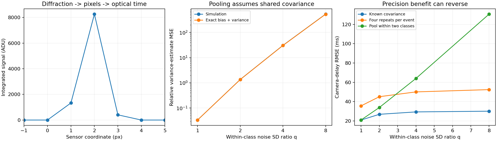

# Pooling clock covariance for optical camera timing

A **45–60 minute integrated learning lab**: when does sharing calibration information improve a camera-delay measurement, and when does the shared-covariance assumption fail? This follows the [independent covariance-estimation lesson](https://github.com/ahmetalpkilic/estimated-clock-covariance-learning-lab), keeping four repeats per event fixed and introducing class pooling plus controlled within-class mismatch.

## Learn and run

Prerequisites: basic Fourier optics, Gaussian covariance, least squares and Python. You will derive a diffraction-limited pixel signal, infer its subpixel center and camera delay, derive pooling degrees of freedom, and validate the bias–variance cost of an incorrect class assumption.

```sh
git clone https://github.com/ahmetalpkilic/pooled-clock-covariance-learning-lab.git
cd pooled-clock-covariance-learning-lab
sh run_demo.sh
```

Requires Python 3.9–3.12 and a POSIX shell. The first run installs pinned NumPy/SciPy/Matplotlib into `.venv`; all data are synthetic and subsequent simulation is offline: `.venv/bin/python lab.py`. The runner executes 11 tests and writes `outputs/results.json` and `outputs/experiment.png`. Reference outputs live in `examples/`. Allow a few minutes for installation.

Spend 10 minutes on the physical model, 10 on the pooling derivation, 10 running/inspecting, 10 on sensitivity, and 5–20 on exercises.

| Area | Explicit model | Learning connection |
|---|---|---|
| Optics | 550 nm Gaussian pupil, scalar Fourier diffraction | Pupil radius sets PSF width |
| Camera | 16 mm focal length, 4 µm integrated pixels, 2 ADU read noise | Sampling constrains subpixel position |
| Vision/metrology | Fit spot position along a known trajectory, infer optical time | Clock calibration sets camera-delay precision |
| Mathematics | Within-event scatter, pooled covariance, exact MSE, latent-time profile fit | Shared information reduces variance but mismatch adds bias |

## Physical model and conventions


The pupil amplitude is `exp(-(rho_x²+rho_y²)/a²)`, with amplitude radius `a=1000 µm`, wavelength `lambda=0.550 µm`, and focal length `f=16000 µm`. This is an **untruncated Gaussian pupil**, not a uniform circular aperture or an f-number model. Scalar paraxial monochromatic Fourier optics, an aberration-free isolated point and instantaneous exposure are assumed.

The Fourier amplitude is proportional to `exp(-(pi*a*x/(lambda*f))²)`. Squaring gives intensity SD `lambda*f/(2*pi*a)`. At pixel pitch `p=4 µm`,

```text
sigma_px = lambda*f/(2*pi*a*p) = 0.350140875 px
mu_j(u) = B + F [Phi((j+0.5-u)/sigma) - Phi((j-0.5-u)/sigma)]
```

`Phi` is the standard-normal CDF; `F=10000 ADU`, `B=20 ADU`. The camera has square pixels, no distortion/skew, principal point `(0,0)` and `K=diag(4000,4000,1)` in pixels. We simulate the horizontal marginal of a separable 2-D PSF. Signed ROI pixel centers are `j=-16,...,+16`, increasing to the right; each integrates `[j-0.5,j+0.5]`. These are not top-left array coordinates.

Each marginal sample receives independent Gaussian read noise of SD 2 ADU. There is no shot noise, saturation, quantization, or photometry fitting; flux, background and optical width are known. Least squares fits `u` using the analytic pixel-integral derivative. This high-SNR toy model isolates clock uncertainty, not a full camera noise budget.

The independently known image trajectory is `u(r)=u0+v*r`, `u0=0.23 px`, `v=0.8 px/reference second`. Clocks obey `r=alpha*t+beta`: true `alpha=1.002 reference s/master s`, `beta=0.030 reference s`. A frame tagged `T=2.0 master s` was exposed at `T+delta`, with true delay `delta=0.040 master s`.

Forty synchronization events span `[-1,+1] master s`. The true event times are **withheld from the estimator**. Even events have timestamp SDs `(0.030,0.020) s`, correlation 0.5. Odd events have SDs `(0.240,0.020*sqrt(8)) s`, correlation 0.2. The base class heterogeneity is fixed at `h=8`. Covariances have units s². Calibration is extrapolated to the frame time beyond the sync interval.

The new sensitivity factor `q=1,2,4,8` multiplies BOTH timestamp standard deviations for half the events **within each class**. Correlations stay fixed; thus `C_i(q)=s_i² C_class`, where `s_i=q` if `floor(i/2)` is odd and 1 otherwise. Classes are known from the experimental design (`i mod 2`), not inferred from evaluation residuals. At q=1 pooling is correctly specified; at q>1 the two labels hide four actual noise populations. Training and evaluation have the same per-event covariance: this is class mismatch, not temporal distribution shift.

## Pool residuals, not timestamp means

Each event has four independent training repeats `w_ik = mu_i + eta_ik`, with unknown fixed pair `mu_i` and independent Gaussian error covariance `C_i`. It also has one independent evaluation pair `z_i`. Every outer trial redraws both datasets. Center each event separately:

```text
S_i = sum_k (w_ik-wbar_i)(w_ik-wbar_i)^T / (m-1)
S_g = sum_{i in g} (m-1) S_i / nu_g
nu_g = sum_{i in g} (m-1) = 20*(4-1) = 60
```

Never take covariance across uncentered timestamps: different event means would count as timing noise. The denominator is 60, not 79; each of 20 events has its own fitted mean. For unequal repeat budgets weight by `m_i-1`; this lab implements equal budgets only. Evaluation pairs are single observations, so **do not divide S_g by m or class size**. Repeat means are never synchronization observations. Fixed-event repeats require a reproducible setup or independently corrected residuals, not just successive timestamps from a moving clock.

Under shared Gaussian covariance, `nu_g*S_g` is Wishart: the sum of 60 independent Gaussian outer products after within-event mean removal. Hence `E[S_g]=C_g` and `Var(S_g,xx)=2*C_g,xx²/60`. A single-event estimate has relative variance MSE `2/3`; class pooling reduces this to `2/60` without increasing the total 160 training pairs.

Under mismatch, let `v_i=C_i,xx`, `K=20`, and `vbar_g=mean(v_i)`. Independent scatter gives an exact check even when the sum is no longer common-scale Wishart:

```text
E[S_g,xx] = vbar_g
Var(S_g,xx) = 2 sum_{j in g} v_j² / [(m-1) K²]
E[(S_g,xx/v_i - 1)²]
 = [(vbar_g-v_i)² + 2 sum_{j in g} v_j²/((m-1)K²)] / v_i²
```

Average that expression over all events to predict the plotted MSE. As m grows, the variance term vanishes but the mismatch bias remains. This is bias of the **variance estimate**, not a claim that downstream mean delay error must be nonzero. Delay is a nonlinear fit; measure its RMSE separately.

### From covariance to optical delay


Treat `S_i` as a plug-in covariance, temporarily fixed during each fit. With latent true time `tau_i`, minimize

```text
Q = sum_i [z_i-(tau_i,alpha*tau_i+beta)]^T S_i^-1
          [z_i-(tau_i,alpha*tau_i+beta)]
```

For `d=(1,alpha)`, differentiation gives

```text
tau_i* = d^T S_i^-1 (x_i,y_i-beta) / (d^T S_i^-1 d).
V_i(alpha) = alpha²*S_i,xx - 2*alpha*S_i,xy + S_i,yy
Q_profile = sum_i (y_i-alpha*x_i-beta)²/V_i(alpha)
beta*(alpha) = sum_i [(y_i-alpha*x_i)/V_i] / sum_i [1/V_i].
```

Search numerically over `alpha in [0.5,1.5]`. The implementation checks a 65-point grid, refines bracketed minima and rejects boundary/flat fits. This is not a global-optimum guarantee for arbitrary data. Independent full latent-event optimization validates the implemented objective. There is no `log V_i` term: this profiles fixed latent times; it does not marginalize random times. With estimated covariance, this is a **plug-in procedure**, not the full likelihood jointly accounting for covariance uncertainty. We make no confidence-interval or coverage claim.

Finally,

```text
r_hat = (u_hat-u0)/v
 delta_hat = (r_hat-beta_hat)/alpha_hat - T
 d(delta) ≈ du/(v*alpha) - d(beta)/alpha - (T+delta)*d(alpha)/alpha.
```

Thus precise optical localization can coexist with poor delay precision when calibration weights are uncertain and rate errors are extrapolated.

Here `S_i` means either the per-event estimate or the class estimate assigned back to event i. The known-covariance oracle uses `C_i` instead.

## Controlled experiment and code guide

All three methods see identical noisy spot centers and evaluation timestamp pairs: known covariance (simulation-only oracle), four-repeat per-event estimates, and pooled class estimates. Three separate seeded random streams generate images, evaluation clocks and training repeats. Shared standard-normal draws pair the four mismatch levels; every outer trial has independent training repeats. There are 600 outer trials per level, with 160 training pairs plus 40 evaluation pairs each.

- `optics.py`: analytic pupil width, exact pixel integration and derivative, bounded subpixel fit.
- `clock_model.py`: covariance geometry, latent-time elimination, rate search, delay conversion.
- `lab.py::estimate`: subtract each event mean before pooling; check positive definiteness.
- `lab.py::predicted_relative_mse`: exact Gaussian bias-plus-variance calculation.
- `lab.py::experiment`: paired mismatch sweep, independent calibration/evaluation, failure counts.

Annotated code comments explain the assumptions at each boundary. Degenerate covariance is rejected, not silently regularized. The demo exits with an error if a clock fit fails; conditional-on-success summaries must not be used as unconditional performance. No confidence interval or uncertainty coverage claim is made. The oracle is a reference, not a universal minimum-RMSE theorem.

## Expected results

| Within-class SD ratio q | Oracle RMSE (ms) | Per-event RMSE (ms) | Class-pool RMSE (ms) |
|---:|---:|---:|---:|
| 1 | 20.982 | 35.633 | 21.020 |
| 2 | 26.913 | 45.130 | 33.967 |
| 4 | 29.398 | 50.095 | 64.011 |
| 8 | 30.133 | 52.460 | 130.598 |

At q=1 the pooled relative variance-estimate MSE is **0.03327**, versus **0.03333** analytically. At q=8 it is **535.80**, versus **530.40** analytically. The mismatch bias dominates the latter. All 600 fits succeed for all three methods at all four levels. Optical center SD is **0.0002737 px**. Pooling benefits correctly grouped events, but reverses by q=4 in this experiment. These trends also pass an independent-seed test.




JSON includes bias, sample SD, RMSE, mean-error Monte Carlo standard error and failed-fit counts. MCSE describes uncertainty of a simulation mean, not device accuracy. Fixed seeds reproduce outputs in the pinned environment; platform differences can affect final digits.

## Validation

Eleven tests check independent pupil FFT width, numerical pixel quadrature and derivatives, noiseless localization/delay, homogeneous generalized-eigenvalue solution, full latent-event optimization, search/invariance properties, invalid inputs, NumPy covariance agreement, event-specific mean removal, pooling permutations, exact MSE via 30,000 independent chi-square draws, and a second-seed 180-trial pooling-benefit/mismatch-reversal experiment. The inherited optical/calibration tests are attributed below. Tests compare independent mathematical constructions rather than copying the implementation.

## Exercises

1. Derive the pooled degrees of freedom for repeat counts 3, 4 and 8 across different events. Implement weighted scatter pooling and validate against manually concatenated centered residuals.
2. Increase m to 32. Predict which term in the MSE changes and why the mismatch floor remains. Update repeat generation and analytic prediction together.
3. Use four labels, splitting each class by the known high/low noise subgroup. Compare reduced mismatch against fewer scatter degrees of freedom per class; evaluate with a fresh seed.
4. Move the frame from T=2 to T=0 and recompute the true spot position. Explain the reduced extrapolation contribution in the delay differential.
5. Add shared drift across training repeats. Identify which independence assumptions and analytic predictions fail; propose an independently measured drift reference.

## Limitations and next lesson

Known optics, photometry, velocity, origin, affine clocks and reproducible repeat settings are assumed. The pupil is Gaussian and untruncated; no hard-aperture Airy pattern, finite exposure, photon noise, common drift, outliers or unknown labels. Pooling does not prove its own assumptions, and the plug-in fit does not integrate covariance uncertainty. **Synthetic repeatability and numerical recovery are not instrument accuracy or traceability.**

Next focused lesson: independently validate covariance classes using held-out calibration repeats, measuring false alarms and detection power for hidden within-class noise differences before selecting a pooling policy. Keep selection repeats separate from final optical-delay evaluation.

## Attribution and source review

New pooling/mismatch code and synthetic data are MIT, copyright 2026 ahmetalpkilic. `optics.py`, `clock_model.py`, `test_clock_model.py`, dependency pins and runner are reused from the [MIT predecessor at 3a322ca](https://github.com/ahmetalpkilic/estimated-clock-covariance-learning-lab/tree/3a322ca0f57f0f30f2949d065f6d744cbfce7d8e); the physical-model/profile derivation is adapted from its README. Its license is preserved in `licenses/`. The predecessor in turn attributes the same author's heteroscedastic and correlated clock lessons.

Reviewed current public [prysm](https://github.com/brandondube/prysm) (MIT, optical context; no copied code), [SciPy](https://github.com/scipy/scipy) and [NumPy](https://github.com/numpy/numpy) (BSD notices), and [Matplotlib](https://github.com/matplotlib/matplotlib) (permissive agreement). [SciPy's Wishart documentation](https://docs.scipy.org/doc/scipy/reference/generated/scipy.stats.wishart.html) provides distribution context. Exact current commits, activity, push dates and full pinned license snapshots are recorded in `sources.json` and `licenses/`. Source-review revisions differ from the runtime versions in `requirements.txt`; current upstream HEAD was not executed. Installed distributions retain their bundled third-party notices.
